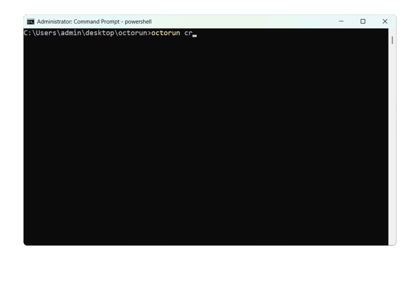
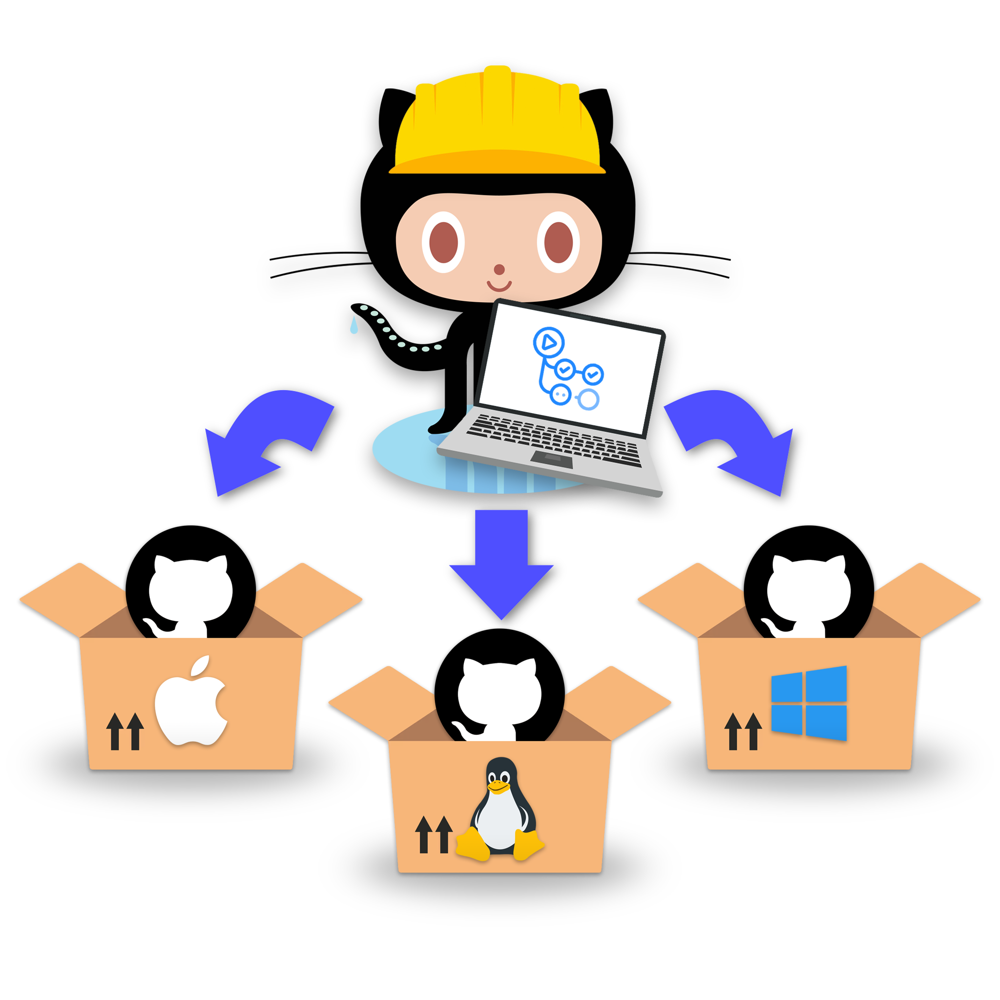
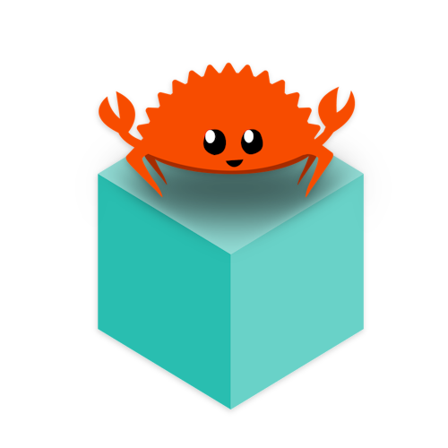

# octorun

[](https://github.com/CHE3MZ/octorun/actions/workflows/ci.yml)
[](https://che3mz.github.io/octorun/)
[](https://crates.io/crates/octorun)
[](https://coveralls.io/github/CHE3MZ/octorun?branch=master)

### octorun is a tool that lets you deploy GitHub Actions local runners at blazingly fast speeds!



# Installation



### octorun works on all the platforms that the [GitHub Actions self hosted runner supports](https://docs.github.com/en/actions/reference/runners/self-hosted-runners)!

## Package managers

<a href="https://github.com/CHE3MZ/homebrew-tools/blob/master/Formula/octorun.rb">
  
</a>

### Brew

```sh
brew install CHE3MZ/tools/octorun
```
<a href="https://crates.io/crates/octorun">
  
</a>

### Cargo install

```sh
cargo install --locked octorun
```

### Cargo binstall

```sh
cargo binstall octorun
```

<a href="https://github.com/CHE3MZ/octorun/releases/latest">
  
</a>

## From the installation scripts

### MacOS & Linux

```sh
curl -LsSf https://raw.githubusercontent.com/CHE3MZ/octorun/master/scripts/install/install.sh | sh
```

### Windows

```sh
irm https://raw.githubusercontent.com/CHE3MZ/octorun/master/scripts/install/install.ps1 | iex
```

# Usage


To get started run the `create` command to create a new runner in the current directory:

```sh
octorun create
```

then run the `start` command to get it up and running:

```sh
octorun start
```

to stop the runner, Ctrl+C the current runner terminal session or run the `stop` command:

```sh
octorun stop
```

to remove the runner run the `remove` command:

```sh
octorun remove
```

if you want temporary runners run the `temp` command:

```sh
octorun temp
```

for more detailed help text run the `help` command:

```sh
octorun help
```

# CI


### If you want to create new empty runners that are **NOT** configured, use the `--no-configuration` flag with the `create` command:

```sh
octorun create --no-configuration
```

# Development



To get started, install [go-task](https://taskfile.dev/) (a.k.a [taskfile](https://taskfile.dev/)), you will need it to run a lot of the local CI jobs.


## Building

```
task build
```

## Ops

```
task ops
```

# License


Huge shoutout to [Dedac](https://github.com/Dedac/) for the project https://github.com/Dedac/gh-runner which this project is based on.

this project is licensed under the [MIT License](LICENSE).
